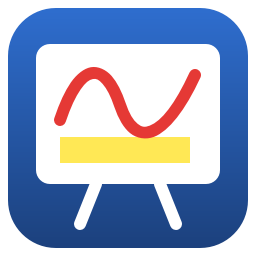

# Pizarra Virtual



**Pizarra Virtual** es una aplicación de escritorio para **Windows 10 y Windows 11** que coloca una
pizarra transparente **sobre todo el escritorio**. Puedes dibujar, subrayar y señalar encima de
cualquier ventana o programa abierto (presentaciones, PDF, navegador, vídeos, código…), con
herramientas parecidas a las de un editor de imagen sencillo, y guardar capturas de pantalla con o
sin lo que has dibujado.

Se distribuye como un único ejecutable **`PizarraVirtual.exe`** que no necesita instalación.

---

## Índice

1. [Características](#características)
2. [Descargar el .exe](#descargar-el-exe)
3. [Cómo se usa](#cómo-se-usa)
4. [Atajos de teclado](#atajos-de-teclado)
5. [Capturas de pantalla](#capturas-de-pantalla)
6. [Compilar el .exe](#compilar-el-exe)
7. [Ejecutar desde el código fuente y pruebas](#ejecutar-desde-el-código-fuente-y-pruebas)
8. [Stack tecnológico y justificación](#stack-tecnológico-y-justificación)
9. [Compatibilidad: Windows 10/11, DPI y varios monitores](#compatibilidad-windows-1011-dpi-y-varios-monitores)
10. [Estructura del proyecto](#estructura-del-proyecto)
11. [Solución de problemas](#solución-de-problemas)
12. [Licencia](#licencia)

---

## Características

| Herramienta | Descripción |
|---|---|
| **Lienzo sobre el escritorio** | Ventana transparente, siempre visible y sin bordes que cubre cada monitor. Se activa y desactiva con **Ctrl+Alt+D** o con el botón **Dibujando / Ratón libre** de la barra. En «Ratón libre» los dibujos siguen visibles pero los clics llegan a las ventanas de debajo. **Ctrl+Alt+H** oculta o muestra la pizarra. |
| **Pincel** | Tamaño ajustable (1–150 px) y cuatro tipos: **Duro** (borde nítido), **Suave** (bordes difuminados), **Aerógrafo** (spray) y **Caligráfico** (punta plana inclinada). |
| **Lápiz** | Trazo fino (1–8 px) con tamaño ajustable. |
| **Pluma** | Trazo preciso que imita una pluma estilográfica: curva suave con bordes limpios, **estabilizador** que elimina el temblor del ratón, **entrada y salida afinadas** y final exacto donde se suelta. Con una **tableta o lápiz con sensor de presión** (Wacom, Surface Pen, Windows Ink…) usa la presión real; **sin tableta, la presión se simula con la velocidad del trazo** (despacio = trazo pleno, rápido = más fino, con cambios graduales). El grosor también varía ligeramente con la dirección, como un plumín inclinado. |
| **Destacador** | Trazo ancho y semitransparente (40 % por defecto) con punta biselada, pensado para resaltar texto. No se oscurece al repasar dentro del mismo trazo. |
| **Goma de borrar** | Borra píxeles de los trazos con tamaño ajustable (4–250 px). Con un lápiz de tableta, el extremo «goma» del lápiz borra automáticamente. |
| **Figuras** | **Rectángulo/cuadrado**, **elipse/círculo**, **triángulo**, **línea** y **flecha**, dibujadas arrastrando el cursor. Con **Mayús** se fuerzan proporciones iguales (cuadrado, círculo) o ángulos de 15° (líneas y flechas). Las figuras cerradas se pueden **rellenar**. |
| **Color y grosor** | Botón de color con selector completo + paleta de 12 colores; deslizadores de **grosor** y **opacidad** (cada herramienta recuerda su propio tamaño y opacidad). También con la **rueda del ratón** sobre la pizarra. |
| **Fondo** | Transparente, «Oscurecer escritorio», «Pizarra blanca» o «Pizarra verde» (para usarla como pizarra tradicional). |
| **Zoom** | **Z**, **Ctrl+Alt+Z** o el botón de la lupa: congela la pantalla donde está el cursor y la amplía (2× al empezar, de 1× a 10×) para hacer énfasis en un detalle. **Rueda** para acercar/alejar centrado en el cursor, **clic derecho (o central) y arrastrar** para moverse, **Esc** para salir. Se puede dibujar encima con cualquier herramienta: los trazos quedan colocados sobre el contenido real al salir del zoom. |
| **Deshacer / rehacer** | Historial ilimitado (también para la goma y «Borrar todo»). |
| **Captura de pantalla** | Con o sin el trazado, de la pantalla actual o de todas, guardada en `%USERPROFILE%\Pictures\Capturas Pizarra` (la carpeta se crea si no existe) y copiada al portapapeles. |
| **Bandeja del sistema** | Icono junto al reloj con menú (modo dibujo, mostrar/ocultar, capturas, ayuda, salir). |

La configuración (herramienta, color, tamaños, posición de la barra…) se recuerda entre sesiones.

## Descargar el .exe

Cada vez que se sube código a `main`, **GitHub Actions** compila el ejecutable en una máquina Windows,
ejecuta las pruebas y un autodiagnóstico del `.exe`:

1. Abre la pestaña **Actions** del repositorio → flujo **«Compilar PizarraVirtual.exe»**.
2. Entra en la ejecución más reciente (en verde) y descarga el artefacto **`PizarraVirtual-exe`**
   (es un `.zip` que contiene `PizarraVirtual.exe`).

Si se publica una etiqueta de versión (`v1.0.0`, `v1.1.0`…), el `.exe` también se adjunta
automáticamente a la página de **Releases**.

También puedes compilarlo tú mismo: ver [Compilar el .exe](#compilar-el-exe).

## Cómo se usa

1. Ejecuta **`PizarraVirtual.exe`**. Aparece la **barra de herramientas** flotante (a la izquierda) y
   el icono en el área de notificación. La pizarra arranca en modo **Dibujando**.
2. Elige una herramienta, un color y un grosor en la barra y dibuja con el ratón, el lápiz o el dedo.
3. Para volver a usar tus programas sin borrar lo dibujado, pulsa **Ctrl+Alt+D** (o **Esc**, o el
   botón *Dibujando*) → pasa a **Ratón libre**: los dibujos siguen visibles pero los clics atraviesan
   la pizarra. Vuelve a pulsar **Ctrl+Alt+D** para seguir dibujando.
4. **Ctrl+Alt+H** (o el botón del ojo) oculta/muestra todo lo dibujado.
5. La barra se **mueve** arrastrando su título («⠿ Pizarra») y se **pliega** con la flecha ⌃: la
   ventana se reduce a la cabecera y se recuerda plegada para la próxima vez.
6. Para **ampliar** una zona, pon el cursor encima y pulsa **Z** (o **Ctrl+Alt+Z** desde cualquier
   programa). Usa la rueda para el aumento, clic derecho y arrastrar para desplazarte, dibuja lo que
   necesites y sal con **Esc**.
7. Para cerrar la aplicación usa el botón de apagado de la barra o *Salir* en el menú del icono de la
   bandeja.

Barra de herramientas (de arriba abajo): modo dibujo · 10 herramientas · tipo de pincel (solo con el
pincel) · relleno (solo figuras cerradas) · color actual y paleta · grosor · opacidad · fondo ·
deshacer, rehacer, borrar todo · zoom, captura, carpeta de capturas · ocultar, ayuda, salir.

## Atajos de teclado

### Globales (funcionan desde cualquier aplicación, aunque la pizarra no tenga el foco)

| Atajo | Acción |
|---|---|
| **Ctrl+Alt+D** | Activar / desactivar el dibujo (Dibujando ↔ Ratón libre) |
| **Ctrl+Alt+H** | Mostrar / ocultar la pizarra |
| **Ctrl+Alt+Z** | Zoom: ampliar la zona de la pantalla bajo el cursor (y salir del zoom) |
| **Ctrl+Alt+S** | Captura de la pantalla actual **con** el trazado |
| **Ctrl+Alt+Shift+S** | Captura de la pantalla actual **sin** el trazado |

### En modo dibujo

| Atajo | Acción |
|---|---|
| **1** | Pincel |
| **2** | Lápiz |
| **3** | Pluma |
| **4** | Destacador |
| **5** | Goma de borrar |
| **6** | Rectángulo / cuadrado |
| **7** | Elipse / círculo |
| **8** | Triángulo |
| **9** | Línea |
| **0** | Flecha |
| **B** | Cambiar tipo de pincel (Duro → Suave → Aerógrafo → Caligráfico) |
| **F** | Activar / desactivar relleno de figuras |
| **C** | Abrir el selector de color |
| **+** / **-** (o **]** / **[**) | Aumentar / reducir el grosor |
| **Rueda del ratón** | Aumentar / reducir el grosor |
| **Mayús + rueda** | Aumentar / reducir la opacidad |
| **Mayús** mientras se arrastra | Cuadrado, círculo, triángulo proporcionado o ángulos de 15° |
| **Clic derecho** | Cancelar el trazo o la figura en curso |
| **Ctrl+Z** | Deshacer |
| **Ctrl+Y** o **Ctrl+Shift+Z** | Rehacer |
| **Supr** | Borrar todo (se puede deshacer) |
| **Z** | Activar / salir del zoom |
| **Esc** | Salir del zoom; fuera del zoom, pasar a «Ratón libre» |
| **F1** | Ayuda con la lista de atajos |

### En el zoom

| Atajo | Acción |
|---|---|
| **Rueda del ratón** | Acercar / alejar (el punto bajo el cursor se queda fijo) |
| **Clic derecho o central + arrastrar** | Mover la vista |
| **Ctrl + rueda** | Grosor de la herramienta |
| **Mayús + rueda** | Opacidad |
| **Esc**, **Z** o **Ctrl+Alt+Z** | Salir del zoom |

El zoom muestra una imagen congelada de la pantalla (los vídeos o animaciones no se mueven mientras
dura); al salir se vuelve a ver el escritorio en vivo con lo dibujado encima.

> Si otro programa ya usa alguno de los atajos globales, Pizarra Virtual lo avisa al arrancar; el resto
> de atajos y todos los botones siguen funcionando.

## Capturas de pantalla

Botón de la cámara (o los atajos globales) → opciones:

- **Pantalla actual con trazado** (`Ctrl+Alt+S`)
- **Pantalla actual sin trazado** (`Ctrl+Alt+Shift+S`)
- **Todas las pantallas con trazado**
- **Todas las pantallas sin trazado**

La «pantalla actual» es la del monitor donde está el cursor. Antes de capturar, la barra y la pizarra
se ocultan un instante para que no aparezcan en la imagen; en las capturas «con trazado» el dibujo se
compone encima a resolución nativa. Si se captura **durante el zoom**, se guarda exactamente la
vista ampliada que se está mostrando.

Las imágenes se guardan en PNG en:

```
%USERPROFILE%\Pictures\Capturas Pizarra\Pizarra_AAAA-MM-DD_HH-MM-SS.png
```

(es decir, la carpeta **Imágenes › Capturas Pizarra** del usuario; se crea si no existe). Además la
captura se copia al portapapeles y se muestra una notificación; al hacer clic en ella se abre la
carpeta.

## Compilar el .exe

### Opción A: script automático (Windows)

Requisitos: **Python 3.10–3.13 de 64 bits** para Windows (marca *Add python.exe to PATH* al instalar).

```bat
build.bat
```

El script crea un entorno virtual `.venv`, instala las dependencias y genera
**`dist\PizarraVirtual.exe`**.

### Opción B: paso a paso (PowerShell o CMD)

```bat
py -3 -m venv .venv
```

```bat
.venv\Scripts\activate
```

```bat
pip install -r requirements.txt -r requirements-dev.txt
```

```bat
pyinstaller --noconfirm --clean PizarraVirtual.spec
```

El resultado es un único archivo, `dist\PizarraVirtual.exe` (sin consola, con icono y metadatos de
versión). Para comprobar que el ejecutable funciona sin abrir la interfaz:

```bat
dist\PizarraVirtual.exe --selftest
```

(devuelve código 0 si todo está bien y deja el detalle en `%LOCALAPPDATA%\PizarraVirtual\pizarra.log`).

### Opción C: GitHub Actions

El flujo [`.github/workflows/build.yml`](.github/workflows/build.yml) hace lo mismo en `windows-latest`
en cada push a `main`, en cada pull request y bajo demanda (*Run workflow*). Para publicar una
versión con el `.exe` adjunto, crea primero sus notas en `notas/vX.Y.Z.md` (se usan como texto de la
release; ver [`notas/v1.1.0.md`](notas/v1.1.0.md)), súbelas y después crea y sube la etiqueta:

```bash
git tag v1.2.0
```

```bash
git push origin v1.2.0
```

También se puede publicar sin crear la etiqueta a mano: en **Actions → Compilar PizarraVirtual.exe →
Run workflow**, escribe la versión (p. ej. `v1.2.0`) en el campo *version*; el flujo crea la etiqueta
sobre ese commit. En ambos casos vuelve a pasar todas las pruebas y, solo si todo va bien, publica la
release con `PizarraVirtual.exe`.

> PyInstaller no compila de forma cruzada: el `.exe` de Windows debe generarse en Windows (en tu PC o
> en el runner de GitHub Actions).

### Regenerar el icono (opcional)

`assets/pizarra.ico` se genera a partir del icono vectorial de la aplicación:

```bat
python tools\make_icon.py
```

## Ejecutar desde el código fuente y pruebas

```bat
pip install -r requirements.txt
```

```bat
python main.py
```

Pruebas automáticas (rasterizado de todas las herramientas, deshacer/rehacer, goma, figuras, pluma
—suavizado, afinado, velocidad, contorno sin huecos—, zoom, barra plegable, modo ratón libre, capturas
y ajustes) con Qt en modo `offscreen`:

```bat
pip install -r requirements-dev.txt
```

```bat
python -m pytest -q
```

(`tests/conftest.py` activa automáticamente `QT_QPA_PLATFORM=offscreen`, así que no se abre ninguna ventana).

`tests/test_windows_native.py` contiene pruebas que solo se ejecutan en Windows con ventanas reales
(`QT_QPA_PLATFORM=windows`): tamaño real de la barra al plegarla, estilos que dejan pasar los clics,
atajos globales y capturas del escritorio que comprueban que el trazo y el zoom se ven de verdad.
GitHub Actions las ejecuta a 100 % y a 150 % de escala en cada compilación.

## Stack tecnológico y justificación

**Python 3.12 + PySide6 (Qt 6.8 LTS) + PyInstaller.**

- **Qt resuelve lo difícil de una superposición en Windows**: ventanas sin bordes, siempre encima,
  con transparencia por píxel (*layered windows*) y que dejan pasar los clics
  (`WindowTransparentForInput` → `WS_EX_TRANSPARENT`), sin tener que escribir todo a mano con Win32.
- **Soporte de DPI moderno**: Qt 6 declara la aplicación *Per-Monitor DPI Aware v2*, así que cada
  monitor se dibuja a su resolución física aunque tengan escalados distintos.
- **Entrada de tableta con presión** (`QTabletEvent`, Windows Ink / WM_POINTER) lista para usar: es lo
  que permite que la pluma use la presión real cuando hay tableta.
- **QPainter** ofrece antialiasing, degradados radiales (pincel suave), modos de composición (goma) y
  opacidad por capa (destacador sin acumulación), suficiente para un editor sencillo y rápido.
- **PySide6 es la binding oficial de Qt** (licencia LGPL, compatible con la GPL del proyecto) y
  **Qt 6.8 es LTS** con soporte oficial para **Windows 10 (1809+) y Windows 11**.
- **PyInstaller** es la herramienta estándar para empaquetar apps Python en un único `.exe` sin
  dependencias para el usuario final, y se integra fácilmente en GitHub Actions.
- Python permite además probar toda la lógica de dibujo de forma automática (Qt *offscreen*).

Se consideró **C# + WPF**, igualmente válido, pero WPF no trae entrada de presión de tableta tan
directa como `QTabletEvent` y la transparencia por píxel con clics que atraviesan requiere más
interoperabilidad Win32; con Qt el resultado es equivalente con menos código específico.

Lo único que se hace con `ctypes` contra la API de Windows es: atajos globales (`RegisterHotKey`), el
identificador de aplicación para la barra de tareas y un refuerzo del estilo *click-through*.

## Compatibilidad: Windows 10/11, DPI y varios monitores

- **Una superposición por monitor**: cada pantalla tiene su propia ventana transparente con un lienzo
  a la resolución física de ese monitor (p. ej. 3840×2160 a 150 %), así que los trazos se ven nítidos
  incluso con escalados distintos entre monitores. La barra de herramientas puede moverse a cualquier
  monitor.
- Los trazos se guardan como **vectores** (puntos, grosores, colores), por lo que si cambias la
  escala o la resolución de Windows con la app abierta, el lienzo se vuelve a renderizar a la nueva
  resolución sin perder calidad.
- **Conexión y desconexión de monitores** en caliente: se crean o eliminan las superposiciones
  automáticamente.
- **Barra adaptable**: si la barra no cabe a lo alto de la pantalla (por ejemplo, un portátil de
  1366×768 con escalado al 125–150 %), se coloca automáticamente en **dos columnas**; al llevarla a
  otro monitor se vuelve a calcular. Su cabecera nunca queda fuera de la pantalla.
- El factor de escala no se redondea (`PassThrough`), para que 125 %, 150 % o 175 % coincidan píxel a
  píxel con la pantalla.
- Las capturas usan los píxeles físicos de cada monitor; «Todas las pantallas» las une en una sola
  imagen según la disposición configurada en Windows.

## Estructura del proyecto

```
Pizarra_Virtual/
├── main.py                       # Lanzador (punto de entrada de PyInstaller)
├── PizarraVirtual.spec           # Configuración de PyInstaller (.exe de un solo archivo, sin consola)
├── version_info.txt              # Metadatos de versión del .exe
├── build.bat                     # Compilación con un clic en Windows
├── requirements.txt              # Dependencias de ejecución (PySide6-Essentials)
├── requirements-dev.txt          # PyInstaller, pytest, Pillow
├── assets/                       # Icono (.ico y .png)
├── tools/make_icon.py            # Genera assets/pizarra.ico
├── pizarra_virtual/
│   ├── main.py                   # Arranque: DPI, instancia única, registro de errores
│   ├── app.py                    # Controlador: estado, historial, modos, capturas, bandeja, atajos
│   ├── overlay.py                # Superposición por monitor: entrada de ratón/tableta y lienzo
│   ├── render.py                 # Rasterizado de pinceles, pluma, destacador, goma y figuras
│   ├── toolbar.py                # Barra de herramientas flotante
│   ├── hotkeys.py                # Atajos globales (RegisterHotKey)
│   ├── capture.py                # Captura de pantalla y carpeta «Capturas Pizarra»
│   ├── icons.py                  # Iconos vectoriales
│   ├── tools.py / items.py       # Definición de herramientas y del modelo de trazos
│   ├── winutil.py                # Utilidades Win32 (ctypes)
│   └── selftest.py               # Autodiagnóstico (--selftest)
├── tests/                        # Pruebas automáticas (pytest)
└── .github/workflows/build.yml   # Compilación del .exe en GitHub Actions
```

## Solución de problemas

- **Windows SmartScreen muestra «Windows protegió su PC»**: el `.exe` no está firmado digitalmente.
  Pulsa *Más información → Ejecutar de todas formas*.
- **El antivirus marca el .exe**: algunos antivirus desconfían de los ejecutables de PyInstaller de un
  solo archivo (falso positivo). Puedes compilarlo tú mismo con `build.bat`.
- **Arranca un poco lento la primera vez**: el `.exe` de un solo archivo se descomprime en una
  carpeta temporal al iniciarse; es normal que tarde 1–3 segundos.
- **Un atajo global no funciona**: otra aplicación lo tiene registrado (la app avisa al arrancar).
  Usa el botón equivalente de la barra o del icono de la bandeja.
- **No puedo hacer clic en mis programas**: estás en modo **Dibujando** (o en el zoom). Pulsa
  **Ctrl+Alt+D** o **Esc** para pasar a **Ratón libre**.
- **Registro de errores**: `%LOCALAPPDATA%\PizarraVirtual\pizarra.log`.

## Licencia

Distribuido bajo la licencia **GNU GPL v2** (ver [LICENSE](LICENSE)). Usa Qt for Python (PySide6) bajo
licencia LGPL v3.
